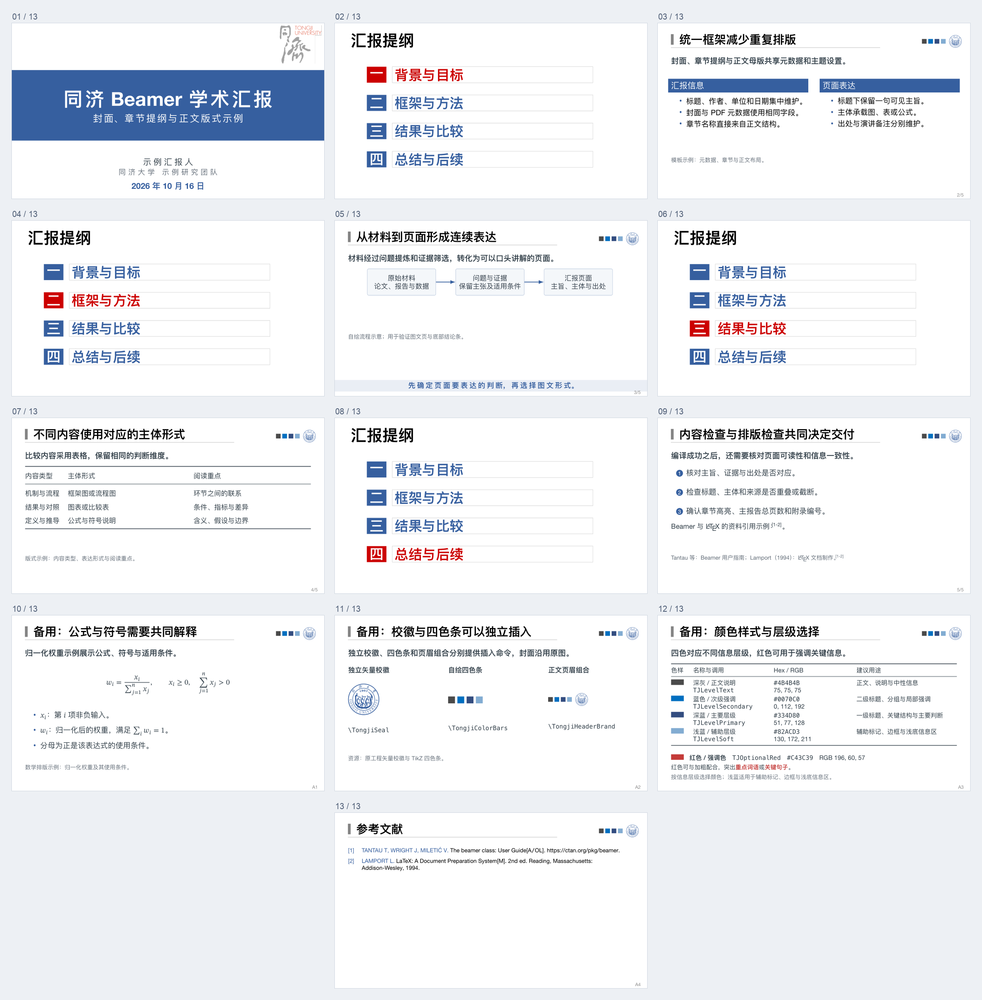
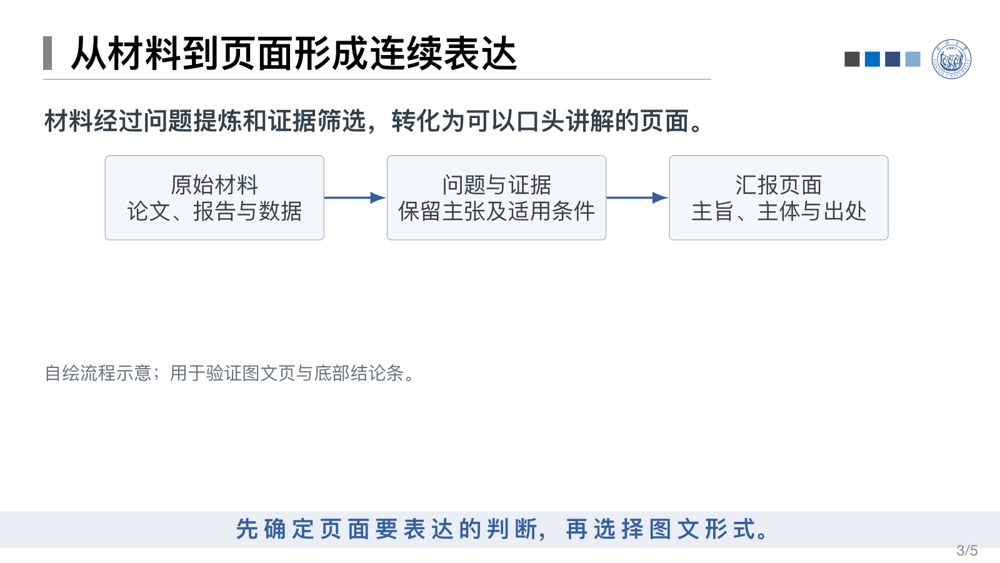

# latex-beamer-ppt-production

用于制作、编译和核验采用同济模板的LaTeX Beamer学术汇报。工作流程见[SKILL.md](SKILL.md)，模板位于[assets/template/](assets/template/)。

## 模板效果

以下预览由当前模板编译生成，包含封面、章节高亮提纲、正文、附录和参考文献。

### 全部页面总览



### 封面


### 章节高亮提纲


### 正文与流程图



## 安装与调用

将本仓库放入 `~/.codex/skills/latex-beamer-ppt-production`，也可从仓库克隆：

```bash
git clone https://github.com/Ran2424/latex-beamer-ppt-production.git ~/.codex/skills/latex-beamer-ppt-production
```

调用 `$latex-beamer-ppt-production`，提供主题、听众、时长及材料。
